# Materi Presentasi Progress Report: Sistem Manajemen Kegiatan ESG & Safety COE

Materi ini disusun untuk presentasi laporan perkembangan (*progress report*) proyek kepada pimpinan, manajemen, maupun tim terkait. Setiap slide dilengkapi dengan **Poin Kunci Visual** dan **Naskah Pembicara (Speaker Notes)** agar presentasi dapat dibawakan secara runtut, profesional, dan meyakinkan.

---

## Struktur Presentasi (10 Slide)

```mermaid
graph LR
    S1[1. Pembuka & Judul] --> S2[2. Latar Belakang & Tantangan]
    S2 --> S3[3. Solusi & Tujuan Proyek]
    S3 --> S4[4. Arsitektur & Tech Stack Efisien]
    S4 --> S5[5. Fitur Utama yang Telah Selesai]
    S5 --> S6[6. Otomatisasi Notifikasi & Reminder]
    S6 --> S7[7. Optimasi Pengalaman Mobile]
    S7 --> S8[8. Status Deployment & Stabilitas]
    S8 --> S9[9. Nilai Manfaat & Dampak]
    S9 --> S10[10. Rencana Lanjutan & Penutup]
```

---

### SLIDE 1: Pembuka & Judul Presentasi

* **Judul Slide**: Progress Report: ESG & Safety COE Management System
* **Sub-judul**: Digitalisasi Agenda Kegiatan, Akuntabilitas PIC, dan Otomatisasi Reminder
* **Presenter**: Tim ESG & Safety COE (Anisya Lutfiyani & Rekan)
* **Tanggal**: Oktober 2026
* **Visual**: Logo perusahaan / COE, tangkapan layar antarmuka dashboard kalender modern.

> 🗣️ **Naskah Pembicara (Speaker Notes)**:
> *"Selamat pagi/siang Bapak/Ibu sekalian. Pada kesempatan hari ini, kami dari tim ESG & Safety COE ingin menyampaikan laporan perkembangan pembangunan sistem manajemen kegiatan terpadu. Sistem ini kami kembangkan untuk mempermudah koordinasi agenda, penugasan personil (PIC), serta memastikan tidak ada kegiatan kritis atau audit yang terlewat melalui otomatisasi pengingat."*

---

### SLIDE 2: Latar Belakang & Tantangan Operasional

* **Judul Slide**: Latar Belakang & Identifikasi Masalah
* **Poin Kunci Visual**:
  1. **Jadwal Tersebar & Manual**: Kegiatan audit, assessment, dan pelatihan K3 sering kali hanya dicatat di spreadsheet personal atau grup WhatsApp.
  2. **Risiko Agenda Terlewat (*Missed Schedule*)**: Kurangnya pengingat proaktif menjelang hari pelaksanaan kegiatan.
  3. **Sulit Melacak Riwayat & Notulensi**: Berkas notulensi rapat dan tautan dokumen terpisah, menyulitkan evaluasi berkala.
  4. **Keterbatasan Visibilitas Tim**: Staf lain sulit mengetahui ketersediaan agenda dan beban kerja PIC secara *real-time*.

> 🗣️ **Naskah Pembicara (Speaker Notes)**:
> *"Sebelum sistem ini hadir, kami mengidentifikasi beberapa kendala operasional. Jadwal kegiatan tim tersebar di berbagai tempat, sehingga koordinasi masih sangat bergantung pada ingatan manual. Dampaknya, ada risiko agenda bentrok, dokumen notulensi yang terselip, serta konfirmasi kehadiran PIC yang memakan banyak waktu komunikasi."*

---

### SLIDE 3: Solusi yang Dibangun & Nilai Tambah

* **Judul Slide**: Solusi: ESG & Safety COE Management System
* **Poin Kunci Visual**:
  * **Single Source of Truth**: Satu pintu terpadu untuk seluruh jadwal dan agenda kegiatan ESG & Safety.
  * **Akses Fleksibel**:
    * **Publik**: Kalender terbuka bagi seluruh staf untuk melihat agenda dan prioritas tanpa perlu login.
    * **Internal (Admin)**: Manajemen PIC, pengeditan agenda, pengunggahan notulensi, dan pengaturan reminder.
  * **Otomatisasi Penuh**: Notifikasi email instan saat ada tugas baru, serta pengingat harian otomatis pada jam kerja pagi.

> 🗣️ **Naskah Pembicara (Speaker Notes)**:
> *"Solusi yang kami bangun adalah sebuah web platform terintegrasi. Platform ini menyediakan kalender publik yang transparan untuk semua pihak, sekaligus panel manajemen bagi tim pengelola untuk mengatur penugasan PIC, prioritas agenda, serta melampirkan tautan notulensi hasil rapat di satu tempat yang aman dan rapi."*

---

### SLIDE 4: Arsitektur Sistem & Efisiensi Anggaran (Zero Cost)

* **Judul Slide**: Arsitektur Berkelanjutan: 100% Free-Tier & Stabil
* **Tabel Komponen Infrastruktur**:
  | Komponen | Layanan yang Dipakai | Status Biaya | Keunggulan |
  | :--- | :--- | :--- | :--- |
  | **Frontend & Backend** | Vercel Serverless (PHP & React) | Gratis (Hobby) | Sangat cepat, CDN global, uptime tinggi |
  | **Database** | Supabase PostgreSQL (Singapore) | Gratis (Tier Bebas) | Keamanan cloud AWS, performa query tinggi |
  | **Email Delivery** | Google SMTP (Gmail) | Gratis | Kapasitas 500 email/hari, masuk inbox PIC |
  | **Scheduler (Cron)** | cron-job.org | Gratis | Pemicu harian jam 07:00 WIB tanpa henti |

* **Sorotan Utama**: **Rp 0 / Bulan** (Tidak membebani anggaran operasional tim).

> 🗣️ **Naskah Pembicara (Speaker Notes)**:
> *"Salah satu keunggulan terbesar dari arsitektur proyek ini adalah efisiensi biayanya. Kami merancang seluruh infrastruktur menggunakan teknologi cloud modern dengan memanfaatkan tier gratis permanen. Hasilnya: sistem ini berjalan 100% tanpa biaya langganan bulanan, namun tetap memiliki keandalan dan keamanan standar industri."*

---

### SLIDE 5: Capaian Modul Utama (Progress 100% Live)

* **Judul Slide**: Capaian Fitur & Modul Utama
* **Poin Kunci Visual**:
  * ✅ **Dashboard Analitik**: Ringkasan jumlah kegiatan, status berjalan/selesai, serta grafik distribusi prioritas.
  * ✅ **Interactive Event Calendar**: Kalender dengan filter prioritas, mode bulan, minggu, hari, dan pencarian cepat.
  * ✅ **Master Data PIC**: Manajemen data personil lengkap dengan validasi email aktif dan nomor kontak.
  * ✅ **Matriks Prioritas**: Pengelompokan kegiatan berdasarkan tingkat kepentingan (*Critical, High, Standard*).
  * ✅ **Dokumentasi Terintegrasi**: Input ringkasan notulensi dan tautan berkas cloud (Google Drive/SharePoint).

> 🗣️ **Naskah Pembicara (Speaker Notes)**:
> *"Bisa kami laporkan bahwa seluruh modul inti saat ini telah selesai dibangun dan siap pakai. Mulai dari Dashboard ringkasan eksekutif, Kalender interaktif, pengelompokan Matriks Prioritas, hingga modul Dokumentasi Notulensi tempat tim dapat langsung menautkan Google Drive hasil rapat."*

---

### SLIDE 6: Otomatisasi Notifikasi & Mekanisme Pengingat

* **Judul Slide**: Fitur Unggulan: Smart Notification & Anti-Spam
* **Poin Kunci Visual**:
  1. **Notifikasi Instan (Event Creation)**:
     - Begitu agenda baru dibuat dan disimpan, email notifikasi otomatis meluncur ke seluruh PIC yang ditugaskan.
  2. **Pengingat Bertahap (Smart Reminders)**:
     - Pengingat otomatis H-3, H-1, dan Hari H (Pukul 07:00 WIB).
  3. **Fitur Anti-Spam Terintegrasi**:
     - Sistem mencatat histori di database (`ReminderLog`). Jika pemicu cron berjalan ulang, PIC tidak akan menerima email duplikat pada hari yang sama.
  4. **Tombol Pengingat Manual (*On-Demand*)**:
     - Memungkinkan admin mengirim pengingat dadakan hanya dengan satu klik pada modal detail kegiatan.

> 🗣️ **Naskah Pembicara (Speaker Notes)**:
> *"Fitur kunci yang paling berdampak adalah otomatisasi pengingat. Admin tidak perlu lagi mengetik pesan WhatsApp satu per satu. Saat agenda disimpan, email undangan langsung terkirim. Setiap pagi pukul 07.00 WIB, sistem juga secara mandiri menyapa PIC yang memiliki agenda pada hari tersebut. Kami juga melengkapinya dengan algoritma anti-spam agar PIC tidak menerima email ganda."*

---

### SLIDE 7: Pengalaman Pengguna pada Layar Ponsel (Mobile Ready)

* **Judul Slide**: Akses Fleksibel: Optimal di Komputer & Smartphone
* **Poin Kunci Visual**:
  * **Tampilan Agenda List Otomatis**: Layar ponsel otomatis menampilkan kartu agenda vertikal yang bersih dan mudah dibaca tanpa perlu geser kanan-kiri.
  * **Pill-Badge Bulanan**: Pada tampilan kalender bulanan di HP, kegiatan tampil sebagai penanda ringkas yang tidak memakan ruang layar.
  * **Toolbar Khusus Mobile**: Tombol pintas untuk beralih instan antara mode **Agenda**, **Bulan**, dan **Hari**.

> 🗣️ **Naskah Pembicara (Speaker Notes)**:
> *"Kami menyadari sebagian besar tim sering berada di lapangan atau rapat luar ruangan. Oleh karena itu, kami merancang antarmuka khusus smartphone. Saat dibuka dari HP, tampilan kalender otomatis beradaptasi menjadi daftar agenda vertikal yang sangat nyaman dibaca dengan satu tangan."*

---

### SLIDE 8: Status Deployment & Uji Coba Lapangan

* **Judul Slide**: Status Deployment & Hasil Pengujian
* **Poin Kunci Visual**:
  * **Domain Live**: `https://coemanagement-kjfs-sigma.vercel.app`
  * **Hasil Pengujian Endpoint Cron**: `200 OK (Success)` terverifikasi pada pengujian live.
  * **Kinerja Pengiriman Email**: Notifikasi email via Gmail SMTP telah diuji ke alamat email internal (Astra & Gmail) dan berhasil masuk ke inbox.
  * **Keamanan Akses**: Dilengkapi enkripsi kata sandi (Bcrypt) dan rute autentikasi terproteksi.

> 🗣️ **Naskah Pembicara (Speaker Notes)**:
> *"Sistem saat ini sudah berstatus live dan dapat diakses publik di cloud. Kami telah melakukan rangkaian pengujian menyeluruh, mulai dari sinkronisasi database cloud, pengujian respons mobile, hingga eksekusi pengiriman email otomatis yang seluruhnya berhasil dengan status sukses (200 OK)."*

---

### SLIDE 9: Dampak & Manfaat Nyata bagi Organisasi

* **Judul Slide**: Dampak Positif & Manfaat Operasional
* **Matriks Dampak**:
  | Indikator | Sebelum Ada Sistem | Setelah Menggunakan Sistem |
  | :--- | :--- | :--- |
  | **Waktu Koordinasi** | 15–30 menit per agenda (manual via chat/email) | < 1 menit (otomatis saat input agenda) |
  | **Kesiapan PIC** | Sering lupa jika jadwal padat | Diingatkan berulang secara rapi (H-3, H-1, Hari H) |
  | **Pencarian Notulensi** | Membongkar chat atau folder personal | 1 Klik langsung dari kalender kegiatan |
  | **Biaya Sistem** | Potensi biaya lisensi software komersial | **Rp 0** (Memanfaatkan teknologi Free Tier) |

> 🗣️ **Naskah Pembicara (Speaker Notes)**:
> *"Dengan implementasi sistem ini, kami memangkas waktu koordinasi secara signifikan. Kesiapan tim meningkat karena adanya pengingat yang konsisten setiap pagi. Yang terpenting, transparansi kegiatan unit ESG & Safety kini berada pada satu standar digital yang rapi dan terukur."*

---

### SLIDE 10: Rencana Tahap Selanjutnya (*Next Steps*) & Penutup

* **Judul Slide**: Rencana Lanjutan & Rekomendasi
* **Poin Kunci Visual**:
  1. **Sosialisasi & User Onboarding**: Membagikan panduan penggunaan dan tautan kalender kepada seluruh anggota tim dan PIC terkait.
  2. **Monitoring Masa Transisi (1–2 Minggu)**: Memantau log pengiriman email harian dan mengumpulkan umpan balik (*feedback*) dari pengguna.
  3. **Peluang Pengembangan Masa Depan**:
     - Sinkronisasi dengan Google Calendar / Outlook (fitur ekspor `.ics`).
     - Pengiriman ringkasan laporan agenda bulanan dalam format PDF/Excel.

> 🗣️ **Naskah Pembicara (Speaker Notes)**:
> *"Sebagai langkah penutup, rencana kami ke depan adalah melakukan sosialisasi kepada seluruh personil PIC dan memantau pemakaian selama 2 minggu pertama. Sistem ini siap digunakan penuh untuk mendukung produktivitas tim ESG & Safety. Terima kasih atas dukungan Bapak/Ibu sekalian, kami membuka sesi tanya jawab dan masukan."*
