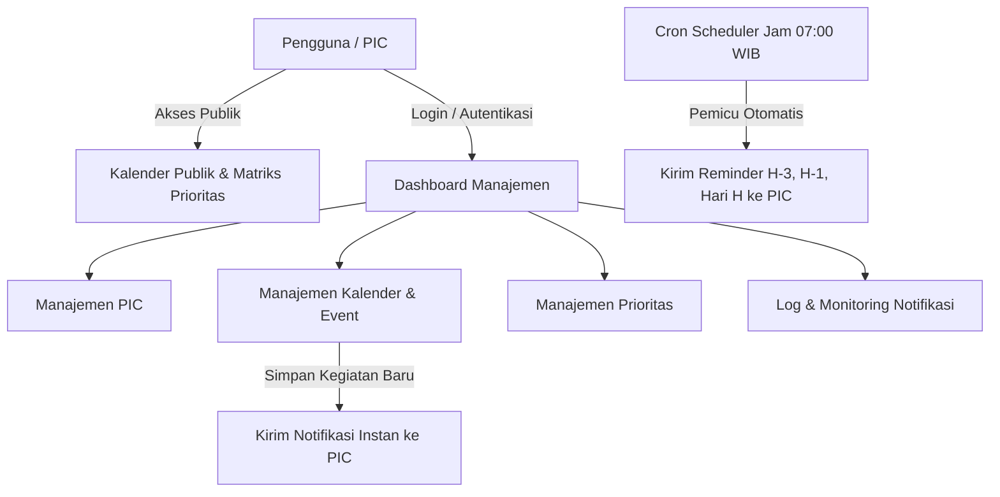
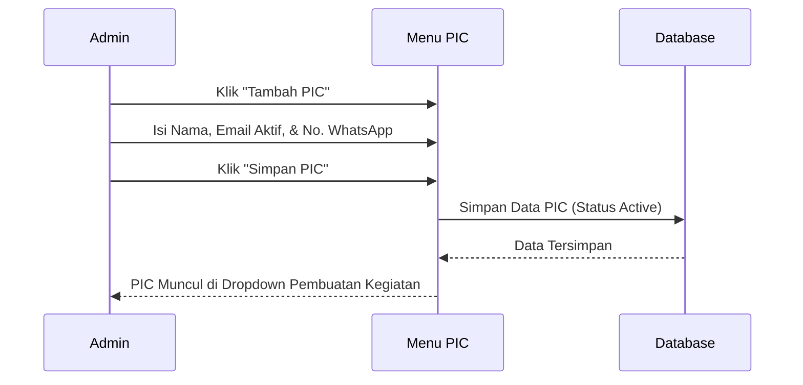
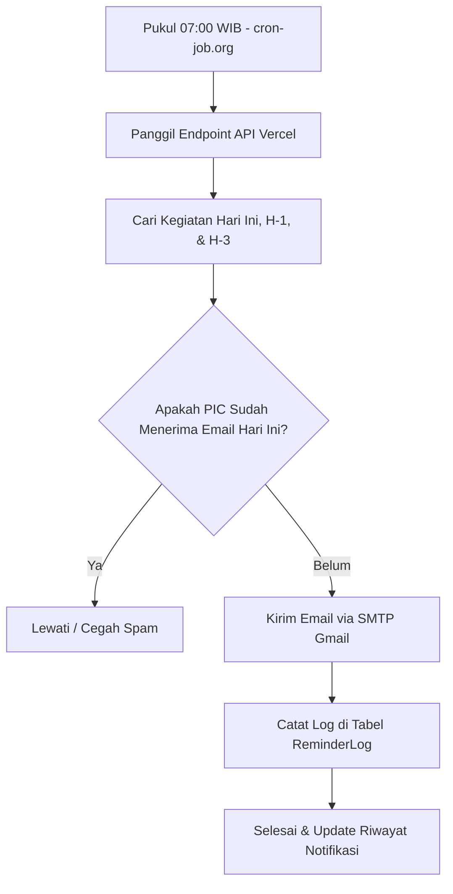

# Panduan Alur Penggunaan Aplikasi ESG & Safety COE Management

Dokumen ini memuat panduan lengkap alur operasional sistem informasi manajemen kegiatan **ESG & Safety Center of Excellence (COE)**, mulai dari tampilan publik hingga pengelolaan internal dan otomatisasi pengiriman reminder.

---

## 1. Ikhtisar & Arsitektur Akses

Aplikasi ini dirancang untuk memudahkan perencanaan, pemantauan agenda, penugasan PIC, dokumentasi notulensi, serta pengiriman notifikasi otomatis untuk seluruh kegiatan di lingkungan ESG & Safety.

### Kategori Hak Akses:
1. **Pengguna Publik (Tanpa Login)**:
   - Mengakses jadwal kalender kegiatan secara terbuka.
   - Memeriksa matriks prioritas kegiatan.
   - Melihat detail kegiatan, lokasi, penyelenggara, dan tautan notulensi.
2. **Tim Pengelola / Admin (Login Diperlukan)**:
   - Mengelola master data PIC (*Person In Charge*).
   - Menambah, mengubah, dan menghapus jadwal kegiatan.
   - Mengatur prioritas dan status kegiatan (*New*, *In Progress*, *Completed*).
   - Mengunggah notulensi dan tautan dokumen hasil rapat.
   - Memonitor status pengiriman email reminder dan memicu pengiriman manual.

---

## 2. Alur Akses Publik (Tanpa Login)

### 2.1 Melihat Kalender Publik
1. Buka alamat website utama: `https://coemanagement-kjfs-sigma.vercel.app/`
2. Halaman menampilkan kalender kegiatan interaktif:
   - **Tampilan Desktop**: Tampilan kotak bulanan interaktif dengan kode warna status kegiatan.
   - **Tampilan Smartphone**: Otomatis beralih ke format **Agenda List** yang ramping dan mudah dibaca tanpa terpotong.
3. Klik pada salah satu agenda untuk melihat detail kegiatan:
   - Tanggal dan rentang waktu pelaksanaan.
   - Lokasi (Ruang rapat atau tautan *online meeting*).
   - Daftar nama PIC yang bertugas.
   - Status kegiatan dan notulensi (bila telah diisi).

### 2.2 Melihat Matriks Prioritas Publik
1. Akses menu **Prioritas** di bilah navigasi atas (`/prioritas`).
2. Kegiatan dikelompokkan berdasarkan tingkat kepentingan:
   - **High Priority** (Merah): Kegiatan mendesak/kritis regulasi.
   - **Medium Priority** (Kuning): Kegiatan operasional berkala.
   - **Low Priority** (Hijau): Kegiatan pendukung/rutin.

---

## 3. Alur Autentikasi & Masuk Sistem

1. Klik tombol **Login** di sudut kanan atas halaman.
2. Masukkan alamat email dan kata sandi yang terdaftar.
3. **Fitur Lupa Password**:
   - Jika lupa kata sandi, klik tautan **Lupa Password?**.
   - Masukkan email terdaftar, sistem akan mengirimkan tautan reset kata sandi langsung ke kotak masuk email Anda.
4. Setelah berhasil login, sistem akan mengarahkan pengguna langsung ke **Dashboard Manajemen**.

---

## 4. Alur Manajemen Master Data PIC (Person in Charge)

Sebelum membuat jadwal kegiatan baru, pastikan data PIC sudah terdaftar agar email notifikasi dapat dikirimkan dengan tepat.

### Langkah Pengelolaan PIC:
1. Buka menu **PIC** di bilah samping kiri (`/pic`).
2. Klik tombol **+ Tambah PIC Baru**.
3. Lengkapi formulir:
   - **Nama Lengkap**: Nama personil yang ditugaskan.
   - **Alamat Email**: Gunakan alamat email aktif (email Astra/perusahaan atau Gmail pribadi). Alamat ini digunakan sistem sebagai tujuan pengiriman notifikasi dan reminder.
   - **Nomor Telepon/WA**: Nomor kontak aktif.
   - **Status**: Pilih **Active**.
4. Klik **Simpan**. PIC yang tersimpan akan langsung tersedia pada pilihan penugasan kegiatan.

---

## 5. Alur Pembuatan & Pengelolaan Kegiatan (Event)

### 5.1 Menambahkan Kegiatan Baru & Notifikasi Otomatis
1. Buka menu **Kalender** (`/kalender`).
2. Klik tombol **+ Tambah Kegiatan** atau klik langsung pada salah satu tanggal di kalender.
3. Lengkapi informasi kegiatan pada jendela modal:
   - **Judul Kegiatan**: Contoh `Training AK3U Batch 2`, `Audit Internal ESG`.
   - **Tanggal Mulai & Tanggal Selesai**: Tentukan tanggal pelaksanaan.
   - **Waktu Mulai & Waktu Selesai**: Jam pelaksanaan (opsional jika kegiatan seharian penuh).
   - **Lokasi**: Lokasi fisik (misal: `Ruang Rapat Nusa 2`) atau tautan daring (misal: `Online Teams`).
   - **Tingkat Prioritas**: Pilih *Standard*, *High*, atau *Critical*.
   - **Pilih PIC**: Pilih satu atau beberapa PIC yang bertanggung jawab atas kegiatan tersebut.
   - **Opsi Reminder**: Centang pengingat yang diinginkan:
     - [x] Pengingat H-3 Sebelum Kegiatan
     - [x] Pengingat H-1 Sebelum Kegiatan
     - [x] Pengingat Hari H (Pukul 07:00 WIB)
     - [x] Pengingat 1 Jam Sebelum Kegiatan
4. Klik **Simpan Kegiatan**.
5. **Aksi Otomatis Sistem**:
   > Sistem secara instan mengirimkan email notifikasi penugasan kegiatan baru ke seluruh alamat email PIC yang dipilih, memuat rincian lengkap agenda, waktu, dan lokasi.

### 5.2 Memperbarui Status & Mengisi Notulensi
1. Klik pada kegiatan yang ingin diperbarui di kalender.
2. Pada modal detail kegiatan, klik tombol **Edit**.
3. Perbarui informasi yang dibutuhkan:
   - Ubah status kegiatan: `New` -> `In Progress` -> `Completed` (Selesai).
   - **Notulensi**: Ketikkan ringkasan hasil kegiatan / *action items*.
   - **Link Notulensi**: Tempelkan (*paste*) tautan penyimpanan berkas (Google Drive, SharePoint, atau PDF dokumen).
4. Klik **Simpan Perubahan**.

### 5.3 Memicu Reminder Manual (On-Demand)
Jika diperlukan pengingat segera di luar jadwal otomatis:
1. Buka modal detail kegiatan yang bersangkutan.
2. Klik tombol **Kirim Reminder Sekarang**.
3. Sistem akan langsung mengirimkan email pengingat terbaru ke semua PIC kegiatan tersebut saat itu juga.

---

## 6. Alur Mekanisme Reminder Otomatis (Background Automation)

Sistem bekerja secara otomatis di latar belakang (*background*) setiap hari untuk memastikan tidak ada agenda yang terlewat.

### Kriteria Pengiriman Otomatis:
1. **Pengingat H-3**: Terkirim otomatis 3 hari kalender sebelum tanggal kegiatan.
2. **Pengingat H-1**: Terkirim otomatis 1 hari kalender sebelum tanggal kegiatan.
3. **Pengingat Hari H**: Terkirim otomatis setiap hari pukul **07:00 WIB** untuk seluruh agenda yang berlangsung pada hari tersebut.
4. **Pencegahan Email Ganda (Anti-Spam)**:
   Setiap kali email berhasil dikirim, sistem mencatat rekam jejak di database (`ReminderLog`). Jika pemicu cron berjalan ulang, sistem tidak akan mengirimkan email duplikat kepada PIC yang sama pada hari yang sama.

---

## 7. Alur Monitoring Notifikasi

Untuk memastikan seluruh email pengingat berhasil sampai ke penerima:
1. Buka menu **Notifikasi** di bilah navigasi (`/notifikasi`).
2. Halaman menampilkan:
   - **Kartu Statistik**: Total email terkirim, email gagal, dan total terkirim hari ini.
   - **Tabel Riwayat Pengiriman**:
     - Judul Kegiatan
     - Nama & Email PIC Penerima
     - Waktu Pengiriman (WIB)
     - Jenis Notifikasi (*Kegiatan Baru*, *H-3*, *H-1*, *Hari H*)
     - Status (*Sent* / *Failed*)

---

## 8. Panduan Penggunaan pada Smartphone (Mobile)

Aplikasi telah dilengkapi optimasi responsif khusus perangkat *mobile*:
1. **Agenda List Otomatis**: Saat dibuka dari browser ponsel, kalender otomatis menampilkan daftar urut agenda (*Agenda List*) berformat kartu vertikal yang rapi tanpa perlu menggeser layar ke kanan/kiri.
2. **Tombol Pengubah Tampilan**: Pengguna tetap dapat beralih antara tampilan **Agenda**, **Bulan** (tampilan pill ringkas), dan **Hari** menggunakan tombol navigasi di bagian atas kalender.
3. **Akses Cepat Detail**: Ketuk pada salah satu kartu agenda di HP untuk langsung menampilkan modal lengkap, status PIC, dan notulensi.

---

## 9. Pertanyaan Umum & Panduan Pemecahan Masalah (Troubleshooting)

### Q: Mengapa email reminder tidak masuk ke kotak masuk PIC?
1. **Periksa folder Spam/Junk**: Pada pengiriman pertama, beberapa penyedia email kantor mungkin menempatkan email otomatis di folder *Spam*. Tandai sebagai *"Bukan Spam"*.
2. **Periksa Penulisan Email PIC**: Masuk ke menu **PIC** dan pastikan tidak ada kesalahan ketik (*typo*) pada alamat email personil.
3. **Cek Menu Notifikasi**: Buka `/notifikasi` untuk memeriksa apakah status email tercatat *Sent* atau *Failed*.

### Q: Apakah ada batasan biaya atau langganan berkala?
Aplikasi dibangun di atas infrastruktur *Free Tier* permanen (Vercel Hobby, Supabase PostgreSQL Free, Gmail SMTP, dan cron-job.org). Tidak diperlukan biaya langganan bulanan untuk penggunaan normal operasional tim.
